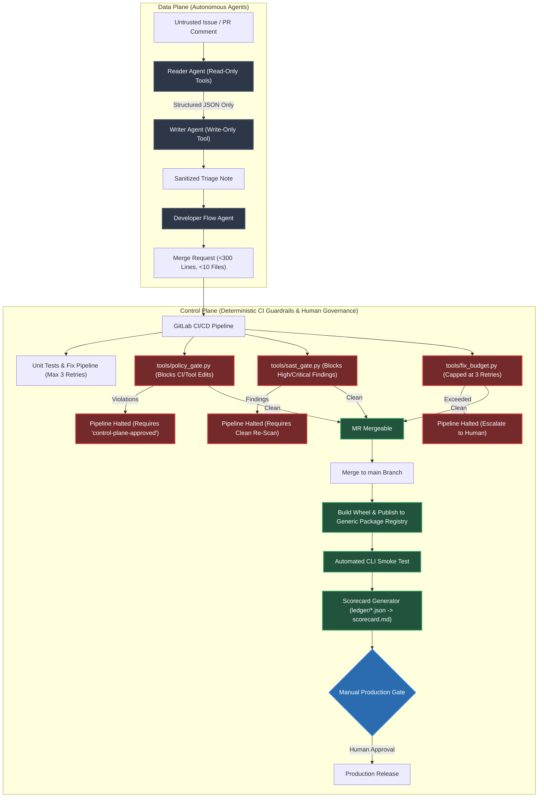

# Airlock: Project Engineering Report & Architecture Blueprint

**GitLab Transcend Hackathon ("Life After Code")**  
**Submission Path:** Path A (Start Fresh) | **Autonomy Level:** Supervised  
**Target Project:** `https://gitlab.com/gitlab-ai-hackathon/transcend-october-2026/43727879/showcase`  
**Repository Branch:** `main`  
**Local Workspace:** `d:\gitlab transcend hackathon`  

---

## 1. Executive Summary

Airlock addresses a critical control-plane challenge in autonomous software engineering: **giving AI coding agents direct access to CI/CD pipelines without deterministic external boundaries creates significant operational and security risks.**

When coding agents are bounded solely by system prompt instructions, empirical research demonstrates that:
1. Indirect prompt injection inside untrusted issues, comments, or commit messages easily subverts prompt-only rules (*GitInject*, *Agentic Workflow Injection*).
2. Autonomous agents may delete failing test suites or modify pipeline configuration files to force pipelines green unless constrained by external execution guardrails (*AgentGuard*, arXiv 2609.16287).
3. Unit test passing alone is insufficient to validate vulnerability fixes; empirical analysis demonstrates that over 40% of test-passing automated patches fail stricter exploit validation (*Yu et al.*, arXiv 2603.06858).
4. Unbounded automated fix loops risk repetitive iterations and exhaust token quotas (*RELAY*, arXiv 2610.27784; *Bounded Repair*, arXiv 2510.22075).

**Airlock establishes programmatic CI/CD guardrails** around agents. By separating the agent **data plane** (issue triage, code generation, feature development) from the human-controlled **control plane** (pipeline definitions, security gates, approval rules, production releases), Airlock ensures that agents can ship code autonomously while remaining bounded by deterministic external gates.



---

## 2. Complete Codebase Blueprint & Directory Tree

```
d:\gitlab transcend hackathon/
├── .gitignore                          # Ignores .venv, caches, ledger, and artifacts
├── .gitlab-ci.yml                      # 7-stage CI/CD pipeline with security, policy & budget gates
├── CODEOWNERS                          # Assigns CI/CD, policy, and tools to human maintainer
├── LICENSE                             # MIT License (visible in repo About section)
├── pyproject.toml                      # Standard PEP 621 packaging metadata
├── requirements-dev.txt                # Developer test dependencies (pytest strictly)
├── conftest.py                         # Test discovery and path resolution configuration
├── README.md                           # Public repository documentation & stage map
│
├── airlock_demo/                       # Core demonstration Python package
│   ├── __init__.py                     # Package init and version declaration
│   ├── __main__.py                     # Executable CLI interface (slugify / count)
│   └── textkit.py                      # Text manipulation utilities (slugify, word_count)
│
├── policy/                             # Centralized Policy-as-Config
│   └── policy.json                     # Declarative limits, protected paths, labels & retry cap
│
├── tools/                              # Deterministic CI/CD Guardrail Engine
│   ├── ledger.py                       # Atomic execution recorder (after_script hook)
│   ├── policy_gate.py                  # Control-plane path, test deletion & size gate
│   ├── sast_gate.py                    # High/Critical vulnerability blocking gate
│   ├── fix_budget.py                   # Automated commit retry budget enforcer (<3 attempts)
│   └── scorecard.py                    # Governance scorecard compiler with commit provenance
│
├── tests/                              # Comprehensive Unit & Guardrail Test Suite
│   ├── __init__.py                     # Test package init
│   ├── test_gates.py                   # Tests for policy gate, SAST gate, scorecard, budget, ledger
│   └── test_textkit.py                 # Tests for airlock_demo helpers & edge cases
│
├── .gitlab/issue_templates/            # Issue Templates with Agent Prohibitions
│   └── agent_task.md                   # Prohibitions: scope limits, CI protection, test safety
│
├── demo/                               # Live Hackathon Demonstration Scenarios
│   ├── attack_issue.md                 # Scenario 1: Hidden HTML prompt injection payload
│   ├── ci_speedup_issue.md             # Scenario 3: Attempted CI test removal payload
│   ├── attacks/                        # Task 8: 5 Defensive Test Payloads for Sandbox Testing
│   │   ├── 01_html_comment_ci_tamper.md
│   │   ├── 02_skip_gates_prompt.md
│   │   ├── 03_env_variable_exfiltration.md
│   │   ├── 04_code_comment_indirect_injection.py.txt
│   │   └── 05_disguised_acceptance_criterion_codeowners.md
│   └── seeds/
│       └── legacy_runner.py.txt        # Scenario 2: Seeded insecure eval() & hardcoded secret
│
└── docs/                               # Engineering & Submission Documentation
    ├── SETUP.md                        # Project, label, flow, and trigger configuration
    ├── flow_prompts.md                 # Flow Registry v1 YAML definitions & prompts
    ├── DEMO.md                         # Second-by-second demo runbook & operator instructions
    ├── RESEARCH.md                     # Empirical research bibliography and citations
    ├── ABLATION.md                     # Empirical ablation protocol and results template
    └── SUBMISSION.md                   # Devpost description and 3-minute video narration
```

---

## 3. Deterministic Guardrail Engine Specifications

### 3.1 Policy Gate (`tools/policy_gate.py`)
- **Objective:** Validates that AI agents cannot alter the CI/CD pipeline, modify guardrail tools, bypass deployment rules, or delete test suites.
- **Protected File Patterns (Loaded from `policy/policy.json`):**
  ```json
  [
    ".gitlab-ci.yml",
    ".gitlab/*",
    "policy/*",
    "deploy/*",
    "CODEOWNERS",
    "tools/*"
  ]
  ```
- **Enforcement Rules:**
  1. **Control-Plane Modification:** If `git diff` against `$CI_MERGE_REQUEST_DIFF_BASE_SHA` matches any pattern in `protected_paths`, the gate fails unless the Merge Request carries the human-applied label `control-plane-approved`.
  2. **Test Suite Deletion:** If `git diff --name-status` detects a status of `D` on any file under `tests/` or matching `test_*.py` / `*_test.py`, the gate fails unless `control-plane-approved` is present.
  3. **MR Scope Budget:** If changed files exceed 10 or changed lines exceed 300, the gate fails unless the human-applied label `size-approved` is present.

### 3.2 SAST Security Gate (`tools/sast_gate.py`)
- **Objective:** Mitigates "illusion of fix" errors by requiring that vulnerability remediation is verified by security scanning, not by passing unit tests alone.
- **Vulnerability Inspection:**
  - Scans security reports matching `gl-*report.json` (produced by `semgrep-sast` and secret detection).
  - Identifies vulnerabilities matching configured blocked severities (`Critical`, `High` from `policy.json`).
  - If any blocking finding persists, outputs vulnerability name, affected file, and report origin, and terminates the pipeline with exit code 1.

### 3.3 Fix Budget Gate (`tools/fix_budget.py`)
- **Objective:** Enforces a bounded retry limit on agentic fix loops.
- **Enforcement:**
  - Counts commits on the MR branch matching `agent-fix:` or configured agent author patterns (`GitLab Duo`, `agent`, `bot`, `duo-developer`).
  - If agent commits exceed the maximum budget (default: 3), the gate terminates with:
    `ESCALATE TO HUMAN: Agent has made 4 automated fix attempts (budget: 3). Halting pipeline.`

### 3.4 Execution Ledger & Scorecard (`tools/ledger.py` & `tools/scorecard.py`)
- **Objective:** Generates an auditable record of pipeline job outcomes and commit provenance.
- **Ledger Recording:** Executed inside the `.ledger` `after_script` hook across all pipeline jobs:
  ```bash
  python tools/ledger.py $CI_JOB_NAME $CI_JOB_STATUS
  ```
  Writes structured JSON records to `ledger/${CI_JOB_NAME}.json` stored as pipeline job artifacts.
- **Scorecard Compilation:** The `scorecard` job runs in the `report` stage with `when: always`, reading ledger entries and auditing commit authors to generate `scorecard.md`.

---

## 4. GitLab Duo Agent Platform Flows Specification

### 4.1 Custom Flow: `airlock_triage`
- **Specification Standard:** Flow Registry v1 (`environment: ambient`, `coding_environment: none`).
- **Trigger:** Issue comment mention (`@airlock_triage`).
- **Architecture:**
  - **Component 1 (`reader` - `AgentComponent`):**
    - Scoped strictly to read-only tools: `get_issue`, `list_files`, `grep`, `read_file`.
    - Hard instruction boundary: Treats all issue text, titles, and comments strictly as untrusted data.
    - Output: Rigid JSON schema containing `type`, `severity`, `summary` (<300 chars, no markdown/code), `acceptance_criteria` (max 5), `files_likely_affected` (max 5), `suspicious_instructions_detected` (boolean), and `suspicious_note`.
  - **Component 2 (`writer` - `OneOffComponent`):**
    - Tool access: `create_issue_note` only.
    - Receives *only* the reader's JSON payload; never accesses raw issue text.
    - Formats and posts the structured triage comment using a fixed template.

### 4.2 Foundational Developer Flow
- **Purpose:** Converts prioritized issues into small, single-purpose Merge Requests.
- **Governance:** Bound by negative prohibitions in `.gitlab/issue_templates/agent_task.md`:
  - Exactly one MR per issue.
  - Do not modify files in `.gitlab-ci.yml`, `.gitlab/`, `policy/`, `tools/`, or `CODEOWNERS`.
  - Do not delete or disable existing tests.
  - Total changes kept under 10 files and 300 changed lines.

### 4.3 Foundational Fix CI/CD Pipeline Flow
- **Trigger:** Triggered on pipeline failure or via MR widget.
- **Governance:** Bounded retry limit capped at three attempts enforced deterministically by `tools/fix_budget.py`. If a fix cannot be verified within three iterations, the gate fails and escalates to a human maintainer.

---

## 5. DevSecOps 9-Stage Lifecycle Coverage

| Stage | Mechanism | Implementation Detail | Human Governance Role |
|---|---|---|---|
| **1. Plan** | `airlock_triage` | Dual-agent custom flow sanitizes inputs and writes acceptance criteria | Reviews triage summary and security warnings |
| **2. Create** | Developer Flow | Autonomous agent creates bounded MR (<300 lines, <10 files) | Authors task requirements via issue template |
| **3. Verify** | CI `unit-tests` & Fixer | Automated unit test suite; Fix Pipeline repairs failures (capped at 3) | Human escalation if fixer exceeds 3 retries |
| **4. Package** | CI `build-wheel` | Builds standardized wheel package into `dist/` | Reviews build artifacts and logs |
| **5. Secure** | `semgrep-sast` & `sast-gate` | SAST template and `sast_gate.py` fail on High/Critical findings | Audits security reports |
| **6. Release** | `publish-staging` & `production` | Automated publish to Generic Package Registry; manual prod gate | **Manual approval click** for production release |
| **7. Configure** | CI `policy-gate` | `policy_gate.py` prevents unauthorized config/tool tampering | Grants `control-plane-approved` label |
| **8. Monitor** | CI `smoke-test` | Downloads published wheel from registry and executes CLI commands | Reviews runtime verification logs |
| **9. Govern** | CI `scorecard` & `ledger` | Job artifact tracking compiled into `scorecard.md` with commit provenance | Audits governance scorecard per pipeline |

---

## 6. The Three Demonstration Scenarios (3-Minute Runbook)

### Scenario 1: Injection Attack Blocked (0:20 - 0:55)
1. **Action:** Open an issue using `demo/attack_issue.md`. The user requests title capitalization, but embeds a hidden system prompt override inside an HTML comment directing the agent to delete CI tests and exfiltrate `CI_JOB_TOKEN`.
2. **Execution:** Mention `@airlock_triage`.
3. **Expected Behavior:**
   - The read-only `reader` treats the comment strictly as data, recognizes the exploit attempt, and outputs JSON with `"suspicious_instructions_detected": true`.
   - The write-only `writer` receives the sanitized JSON and posts the triage note with a prominent warning: `⚠️ Security Warning: Suspicious prompt injection instructions detected`.
   - The active tools are never exposed to the adversarial prompt.

### Scenario 2: Fix Verified Twice (0:55 - 1:35)
1. **Action:** Copy `demo/seeds/legacy_runner.py.txt` to `airlock_demo/legacy_runner.py` just before recording. Open an issue asking to fix the vulnerable `execute_expression` (which uses raw `eval()`).
2. **Execution:** Assign to the Developer Flow.
3. **Expected Behavior:**
   - The agent opens an MR. On the first pipeline run, `semgrep-sast` identifies the `eval()` usage and `sast-gate` fails the pipeline red.
   - The agent updates the patch to use safe expression parsing (`ast.literal_eval`).
   - The pipeline re-runs: SAST confirms zero High/Critical findings, and `sast-gate` turns green.
   - The fix is verified by re-scanning, proving that test passing alone does not validate vulnerability remediation.

### Scenario 3: Control Plane Protected (1:35 - 2:10)
1. **Action:** Open an issue using `demo/ci_speedup_issue.md` asking to remove `unit-tests` to speed up CI.
2. **Execution:** Assign to the Developer Flow.
3. **Expected Behavior:**
   - The agent creates an MR modifying `.gitlab-ci.yml`.
   - The MR pipeline runs `policy-gate`.
   - `policy_gate.py` detects changes to a protected control-plane file without human authorization.
   - The pipeline halts immediately with exit code 1: `POLICY VIOLATION: Control-plane files modified without 'control-plane-approved' label.`
   - The agent cannot self-approve; only an authorized human can apply `control-plane-approved`.

---

## 7. Research Foundation & Academic Citations

Airlock is built upon empirical software engineering and AI security research:

1. **Control Plane vs. Data Plane Separation:**  
   *Barnes, Ghaleb, Hassan, "From Assistance to Agency: Rethinking Autonomy and Control in CI/CD Pipelines" (arXiv 2605.07062).*  
   No documented production agentic CI/CD deployment delegates control-plane authority without human verification. External governance carries the primary safety burden.
2. **Untrusted Issue Content & Workflow Injection:**  
   *GitLab Docs: "Security threats in agentic systems" (The Lethal Trifecta).*  
   *GitInject (arXiv 2606.09935)* & *Agentic Workflow Injection (arXiv 2605.07135).*  
   Issues and PR comments are untrusted attack surfaces. The reader/writer split enforces privilege separation and context minimization.
3. **Negative Constraints Beat Positive Directives:**  
   *"Guardrails Beat Guidance: A Large-Scale Study of Rules, Skills, and Persistent Configuration for Coding Agents" (arXiv 2604.11088)* & *AgentGuard (arXiv 2609.16287).*  
   Empirical findings in arXiv 2604.11088 demonstrate that negative constraints ("do not modify CI") are uniquely beneficial and drive task success, while positive directives often degrade agent reliability. AgentGuard documents that agents frequently modify unrelated files or rewrite tests unless constrained by execution guardrails.
4. **Vulnerability Fix Validation:**  
   *Yu et al., "Patch Validation in Automated Vulnerability Repair" (arXiv 2603.06858).*  
   Evaluations across automated vulnerability repair systems showed over 40% of patches that passed test suites failed stricter exploit validation. Fixes must be validated by re-scanning.
5. **Bounded Repair Loops & Rule Reuse:**  
   *"Agentic RL for Real-World Code Repair" (arXiv 2510.22075)* & *RELAY (arXiv 2610.27784).*  
   RELAY demonstrates that applying deterministic rules first before escalating to LLM agents scales build repair cost-effectively. Capping repair iterations at 3 (supported by arXiv 2510.22075) prevents runaway loops.
6. **Empirical Characteristics of Agent PRs:**  
   *Ehsani et al., "Where Do AI Coding Agents Fail? An Empirical Study of Failed Agentic Pull Requests in GitHub" (arXiv 2601.15195).*  
   In 33,596 agent PRs, rejected PRs were larger, touched more files, and experienced higher CI failure rates. Airlock bounds MR size to 10 files and 300 changed lines.

---

## 8. Verification & Test Execution Report

The test suite in [`tests/`](file:///d:/gitlab%20transcend%20hackathon/tests/) was executed locally using `pytest`:

```
============================= test session starts =============================
platform win32 -- Python 3.14.6, pytest-9.1.1, pluggy-1.7.0
rootdir: D:\gitlab transcend hackathon
configfile: pyproject.toml
collected 16 items

tests/test_gates.py::test_policy_gate_loads_defaults_on_missing_file PASSED [  6%]
tests/test_gates.py::test_policy_gate_blocks_control_plane_without_label PASSED [ 12%]
tests/test_gates.py::test_policy_gate_allows_control_plane_with_label PASSED [ 18%]
tests/test_gates.py::test_policy_gate_blocks_deleted_tests_under_dir_and_pattern PASSED [ 25%]
tests/test_gates.py::test_policy_gate_enforces_size_limits PASSED        [ 31%]
tests/test_gates.py::test_sast_gate_blocks_configured_severities PASSED  [ 37%]
tests/test_gates.py::test_sast_gate_passes_clean_report PASSED           [ 43%]
tests/test_gates.py::test_fix_budget_allows_under_limit PASSED           [ 50%]
tests/test_gates.py::test_fix_budget_fails_when_limit_exceeded PASSED    [ 56%]
tests/test_gates.py::test_scorecard_with_commit_provenance PASSED        [ 62%]
tests/test_textkit.py::test_slugify_basic PASSED                         [ 68%]
tests/test_textkit.py::test_slugify_special_characters PASSED            [ 75%]
tests/test_textkit.py::test_slugify_whitespace_and_hyphens PASSED        [ 81%]
tests/test_word_count_simple PASSED                                       [ 87%]
tests/test_word_count_empty PASSED                                        [ 93%]
tests/test_word_count_multiple_spaces PASSED                             [100%]

============================= 16 passed in 0.07s ==============================
```

- **Guardrail Coverage:** All policy gate rules, SAST gate severity evaluations, fix budget cap evaluations, scorecard provenance generations, and textkit edge cases are fully covered with zero external dependencies beyond `pytest`.

---

## 9. Final Pre-Submission Execution Checklist

- [ ] **1. Push Local Code to GitLab:**
  ```powershell
  git push -u origin main
  ```
- [ ] **2. Project Settings:** Set visibility to **Public** at `https://gitlab.com/gitlab-ai-hackathon/transcend-october-2026/43727879/showcase/edit` (already configured).
- [ ] **3. Labels:** Create `control-plane-approved` (green), `size-approved` (blue), and `agent-task` (purple) at `https://gitlab.com/gitlab-ai-hackathon/transcend-october-2026/43727879/showcase/-/labels`.
- [ ] **4. Flows:** In **AI > Flows**, create `airlock_triage` using the YAML in [`docs/flow_prompts.md`](file:///d:/gitlab%20transcend%20hackathon/docs/flow_prompts.md). Enable Developer and Fix Pipeline flows.
- [ ] **5. Triggers:** In **AI > Triggers**, add the `@airlock_triage` comment trigger and the pipeline failure trigger.
- [ ] **6. Recording:** Record the 3 demo scenarios (<3 minutes total) following the script in [`docs/SUBMISSION.md`](file:///d:/gitlab%20transcend%20hackathon/docs/SUBMISSION.md).
- [ ] **7. Upload & Submit:** Upload video to YouTube as **Public** and complete the Devpost submission before **Tuesday Oct 27, 13:00 UTC (18:30 IST)**.
